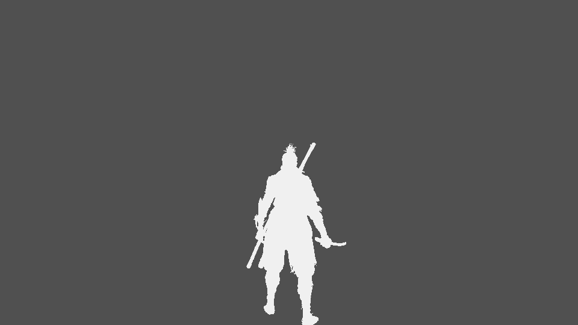
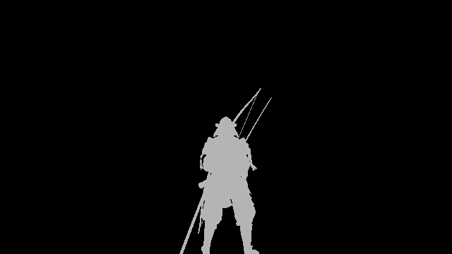

G-buffer programs write surface properties into five render targets. Deferred lighting interprets them by target
and channel; the two games carry the same set of surface properties but put several of them in different lanes, and
Elden Ring's target 3 has only two channels (`R8G8_UNORM`; Sekiro's is `R8G8B8A8_UNORM`). :observed[the targets of the
G-buffer pass in one Sekiro frame and two Elden Ring launches]

The table follows the G-buffer programs drawn in one frame of each game, traced from each target lane back to the
textures, constants and vertex inputs it is computed from, and the programs drawn after the G-buffer pass that read the
targets. It does not assign a surface meaning merely because a target contains a nonzero value. :observed

| Target/lane | Sekiro | Elden Ring | Confidence |
|---|---|---|---|
| 0 RGB | Biased world normal | Biased world normal | :observed |
| 0 A | Zero (a decal's coverage, used only for blending); not read | Zero (a decal's coverage, used only for blending); not read | :observed[the frame's G-buffer and reading programs] |
| 1 R | Gloss | Metallic | :observed |
| 1 G | Diffuse wrap term, used where positive | Gloss | :observed |
| 1 B | Occlusion, from the second vertex colour's red | Translucency (diffuse wrap and transmission), stored as a tenth | :observed[the frame's G-buffer and reading programs] |
| 1 A | Subsurface-scattering profile index | Occlusion, from the second vertex colour's red | :observed[the frame's G-buffer and reading programs] |
| 2 RGB | Albedo | Albedo | :observed |
| 2 A | Subsurface-scattering strength | Light-set selector (the instance's `envData` over 255) | :observed[the frame's G-buffer and reading programs] |
| 3 RGB | Square root of reflectance F0 | R: subsurface-scattering strength; G: subsurface-scattering profile index; no B | :observed{games="sekiro"} :observed[the frame's G-buffer and reading programs]{games="elden-ring"} |
| 3 A | Light-set selector | No such lane | :observed{games="sekiro"} :observed[two launches]{games="elden-ring"} |
| 4 RGB | Emission radiance | Emission radiance | :observed |
| 4 A | Glow weight: the share of the emission sent to the bloom chain | Glow weight: the share of the emission sent to the glow chain | :observed[the frame's G-buffer and reading programs] |

## Normal, gloss and reflectance

Both games' writers encode a world normal as `n * 0.5 + b`, where `b` has float bits `0x3F002008`
(approximately 0.50048876). The lighting path decodes with `x*2-1` and normalizes. :observed

Elden Ring's target 0 normal is in the map's left-handed frame, not the view's and not a Z-reflected one. In one frame at
the Stormveil gate, normals rebuilt from the depth target with the frame's own projection and view matrix (the scene
constants), turned into world space, agree with the decoded target 0 normal to a median of 0.2° about the vertical over
2.18 million steep pixels; the view-space normals differ by a median of 10.75°, the camera's yaw from the world being
10.55°, and against the Z-reflected world normals the median dot product is −0.08. :observed[one frame, the targets read
back before the directional light draw]{games="elden-ring"}

No pass keeps the normal map's variance. Each G-buffer program that reads a normal map decodes its red and green as
`2t - 1`, rebuilds `z = sqrt(1 - saturate(dot(xy, xy)))`, normalizes the result of the tangent frame and writes that, and
`dot(xy, xy)` has no other use: no Toksvig- or LEAN-style roughness term. :observed[every use of the self-dot in the 42
G-buffer pixel programs drawn at Sekiro's `m11_01` (40 of which unpack a normal) and in 28 of Elden Ring's] Elden Ring's deferred
light programs `GXLightAcc_DDirLightShadowed1`, `GXLightAcc_DPointLight1`, `GXLightAcc_DSpotLight1` and
`GXLightDeferredAOEnvMapRegionFresnelPreMultiply` load target 0's RGB, decode it as `2t - 1` and use its squared length only
through `rsqrt` to rescale it to unit length, so the stored normal's length carries nothing either; they read the gloss
from target 1's green (`sqrt`, then the remap below). The point light widens the roughness by a term of the light's
distance and size, `(1 / (3.5x² + 5))^0.25`, an area-light correction, not by normal variance. :observed[the DXIL of these
four programs]{games="elden-ring"}

The surface-only gloss interpretation is `roughness = 1 - 0.95*sqrt(gloss)`. The directional light additionally
uses `sqrt(k*gloss)`, with `k = 1 - 0.75*0.1/w`, where `w` is a light-direction constant; the captured runtime
distribution of that constant is not established. :observed Elden Ring's directional light forms
`r = 1 - 0.95*sqrt(k*gloss)` per light and uses `α = r²` in its GGX distribution, which therefore evaluates `r⁴`.
:observed{games="elden-ring"}

Sekiro reconstructs `F0 = RT3.rgb * RT3.rgb` and uses it in the Schlick term
`F0 + (1-F0)*(1-dot(L,H))^5`. Elden Ring instead forms `F0 = lerp(0.04,albedo,metallic)`.
:observed

## Emission and normal-map basis

A normal texture's blue channel is not the normal's Z: the programs rebuild Z from red and green. :observed In
Ashina Castle's normal maps, blue averages 38 to 64 of 255, far from the Z that red and green imply.
:observed{games="sekiro"} Elden Ring's inspected G-buffer programs write normal-texture blue as gloss (target 1 G).
:observed{games="elden-ring"}

Among 100 Elden Ring G-buffer programs inspected from c2010, c2050, c2120 and Liurnia, target-4 RGB carries either
zero or radiance, not a mask or velocity. Emissive families multiply colour, intensity and the emissive map by
`SC_PreExposure`; the alpha lane is the glow weight (below). :observed{games="elden-ring"}

For the inspected ordinary layered programs, sampled normal X follows `cross(N,T)*T.w`, and sampled normal Y
follows `T`. SpeedTree programs use a different stored tangent convention, described under
[SpeedTree](/engines/fromsoft/vegetation/speedtree/). :observed

## Occlusion, translucency, light sets, subsurface scattering and glow

The lanes below were traced in the 42 pixel programs that write the G-buffer in one Sekiro frame by a Sculptor's Idol
in Ashina and the 62 of one Elden Ring frame at the Stormveil gate (each through its draw's vertex program to the
vertex attribute), and in the programs drawn after the G-buffer pass that read them. The values are the targets' contents in those frames:
Sekiro's read back at the end of the G-buffer pass (1920×1080, 2,073,600 pixels); Elden Ring's as the frame began,
left by the frame before (2560×1440, 3,686,400 pixels), in two launches whose counts agree to within 0.03%. :observed

**Alpha of every target in decal draws.** Both games' G-buffer programs test `FC_AlphaRef.z`: where it is nonzero, the
alpha of every target they write carries the draw's coverage (diffuse alpha times the instance colour's alpha) instead
of its usual content. :observed In Sekiro's frame exactly the 9 draws with `FC_AlphaRef.z = 1` use a blend state that
mixes RGB by source alpha and does not write alpha, so the coverage blends the decal in and is never stored.
:observed[one frame]{games="sekiro"} Target 0's alpha is otherwise written as zero; it is zero on every pixel of both
games' frames, and no program reads it. :observed[one frame of each game]

**Occlusion.** Both games store a per-vertex occlusion, the red of the second vertex colour (`COLOR1.x`), Sekiro in
target 1's blue, Elden Ring in target 1's alpha. :observed Sekiro's layered `Multiple` programs multiply it by their
normal maps' alpha and a character program by the red of a texture its material names `AO_SSS`;
:observed{games="sekiro"} Elden Ring's detail-blend and skin programs multiply it by texture alphas.
:observed{games="elden-ring"} The composite shadow-mask program
(`GXRend_CompositeShadowMask`) writes `FC_Mult * lane + FC_Add` into the screen shadow texture's green and blue
beside the screen-space occlusion in red; both frames have `FC_Mult = (0,1,0,0)` and `FC_Add = (1,0,1,1)`, so green
holds the lane and blue is 1. :observed[one frame of each game] The ambient light then darkens by
`SSAO × occlusion` in Sekiro and by `min(SSAO, occlusion)` in Elden Ring, whose directional light also applies
`lerp(1, min(SSAO, occlusion), FC_SsaoWeight)` with the light set's weight. :observed Sekiro's lane is 255 on 1,699,699
pixels and averages 0.988; Elden Ring's is 255 on all but 401. :observed[one frame of each game]

**Translucency.** Elden Ring's vegetation, grass, flag and SpeedTree programs write `0.1 ×` a translucency (the
material's `FC_TranslucencyScale`, or SpeedTree's translucency texture remapped by `u_fTranslucencyRange`) into target
1's blue, and the other programs write zero. The directional light reads `w = 10 × blue`; where `w > 0` it lights the
surface by `max(N·L + w, 0) / (1 + 20 × blue)` instead of `saturate(N·L)` and adds a transmission lobe
`saturate(dot(L, d))^32`, `d` the view direction, weighted by `w / (1 + w)`. :observed{games="elden-ring"} The factors
10 and 20 are those Sekiro applies to its target 1 green. :observed The lane is zero on all but 2,861 pixels at the
Stormveil gate. :observed[two launches]{games="elden-ring"}

**Light sets.** Both games store the light set an instance is lit by as an integer over 255: Elden Ring in target 2's
alpha, from the per-instance record's `envData` (register 5 of a 13-register record), Sekiro in target 3's alpha, from
register 5 of its 17-register record. :observed Elden Ring's directional light reads `int(alpha × 255) × 14` as the
first register of a set of four directions, four diffuse and four specular colours, `bLocalLight` and `FC_SsaoWeight`,
in a 50,432-byte buffer of such sets. :observed{games="elden-ring"} In both games' frames the player's pixels select set
3: 167,082 Elden Ring pixels against 3,519,318 of set 0, and 77,973 Sekiro pixels against 1,994,835 of set 1.
:observed[one frame of each game]

:::slides[The light-set lane]

Sekiro, target 3 alpha at the end of the G-buffer pass, the stored index times 80 (set 1 grey, set 3 white), at half
size.

Elden Ring, target 2 alpha as the frame began, the stored index times 60 (set 0 black, set 3 grey), at quarter size.
:::

**Subsurface scattering.** The two blur passes (Elden Ring names them `GXSssBlurX` and `GXSssBlurY`) read a profile
index as `int(x × 255)`,
take 18 registers from it (`sssWidth` and a 17-tap `kernel`) in `cbSSS.g_profileArray`, and scale the blur's width by
the strength lane. :observed Sekiro reads the index from target 1's alpha and the strength from target 2's; Elden Ring
reads both from target 3, the index in green and the strength in red. :observed The index comes from the material's
`FC_SSS_ID` over 255 in the programs that write it and is zero in the rest. :observed Neither frame has a nonzero
index: in Sekiro's, `FC_SSS_ID` is 0 in all 59 draws of the 3 programs that write it, and Elden Ring's target 3 is zero
on every pixel. :observed[one frame of each game]

**Glow.** The light combine writes `max(irradiance + specular + emission, 0)` to the lit image and `emission × target
4 alpha` to a second target that later forward passes add to; that target is the source of a chain of downsamples:
Sekiro's from 960×540 to 15×9 and back, Elden Ring's through `EmissiveToGlowPS` into 1280×720, 640×360 and smaller.
:observed[one frame of each game] Programs of glowing materials write `FC_GlowScale.w` times the glow texture's alpha
there. :observed In Sekiro's frame the lane is 1 on 9,108 pixels, most of them the player's hair and wrappings, whose
emission is zero, and 0 elsewhere; Elden Ring's is zero on every pixel. :observed[one frame of each game]

:::open[What chooses an instance's light set?]
The light-set lane is the per-instance `envData` (Elden Ring's name; Sekiro's record has no field names), an index into
the frame's buffer of light sets. Which map or parameter data sets it, and how the indices relate to the light sets'
file IDs, is not established. :unknown
:::

:::open[What do the subsurface-scattering lanes hold where skin is drawn?]
Neither frame draws a surface with a nonzero profile index, so the captured values of the profile and strength lanes
are all zero; their range on skin is not measured. :unknown
:::

## Sekiro

### Reflectance, light groups and diffuse wrap

In the inspected Sekiro Multiple, MultipleGround and Multiple_Emissive switch population, the constant dielectric
encoding is RGB float bits `0x3E315CAC`, whose square is approximately 0.03. Multiple switch 18 has variable
reflectance, so the constant value is not a rule for every switch. :observed{games="sekiro"}

Sekiro's target-3 alpha selects the light group: `int(alpha*255)*18` identifies its first row in the light buffer.
In a frame at the Ashina Castle gate, of the 1,695,266 pixels with geometry, 1,531,746 select group 1, 163,465 group 3 and
55 group 0; group 1's first diffuse colour is (1.25, 0.769, 0.433, 1.5625). These are indices into the frame's buffer, not
yet tied to the light sets' file IDs. :observed[one frame, the target read back]{games="sekiro"}
The target-1 green value modifies the diffuse wrap term with factors 10 and 20 where it is positive.
:observed{games="sekiro"}

### Who reads each lane

In a frame at the Ashina Castle gate, 14 pixel programs read the five targets after the G-buffer pass. The lanes each
keeps from its reads (the destination masks of every `sample` and `ld` of the target) are: :observed[one captured
frame]{games="sekiro"}

| Target | Lanes read |
|---|---|
| 0 | RGB, by 9 programs in 61 draws |
| 1 | R, by 5 programs in 55 draws, among them the 42 draws that accumulate the lights; R and G, by 2 programs; B, by the composite shadow-mask program (above); A, by 2 programs that name the register `g_SSSProfileIDTexture` |
| 2 | RGBA, by the program that multiplies the irradiance by the albedo (its target has no alpha); A, by the same 2 programs as target 1's alpha, as `g_SSSStrengthTexture` |
| 3 | RGB, by 4 programs; A, by one of them |
| 4 | RGBA, by one program, which writes `max(irradiance + specular + emission, 0)` to the lit image and `emission × A` to a second target |

No program reads target 0's alpha. :observed[one captured frame]{games="sekiro"} The two programs that read target 1's
and target 2's alphas use them as a subsurface-scattering profile index and strength, as described above, and name
the registers accordingly. :observed[one captured frame]{games="sekiro"} In the frame by the idol, the occlusion in
target 1's blue reaches the light through the shadow texture's green, which the ambient combine multiplies by the
screen-space occlusion in its red into both the ambient diffuse and the ambient specular (environment and
screen-space reflection); the sun reads the shadow texture's red and alpha only. :observed[one captured
frame]{games="sekiro"}

## Elden Ring

### Combining the light

After the lights accumulate, `GXLightCmbAlbedo` outputs `A*(1-m)` from target-2 albedo and target-1 metallic and is
drawn with blend `DEST_COLOR / ZERO`, so it multiplies the accumulated diffuse light by the diffuse albedo.
`GXLightComposite` then sums diffuse, specular and emission. The programs and a Limgrave capture agree on both.
:observed{games="elden-ring"}

### Who reads each lane

In a frame at the Stormveil gate, 13 pixel programs drawn after the G-buffer pass read its targets. The lanes each
takes from its loads and samples of a target (the components it extracts) are: :observed[one captured
frame]{games="elden-ring"}

| Target | Lanes read |
|---|---|
| 0 | RGB, by `ScreenSpaceAO2_WithNormal`, `GXSsrNew`, the two `GXEnvMapRegion[Box]` programs, `GXLightDeferredAOWithSsr`, `GXLightAcc_DDirLightShadowed1`, `GXLightAcc_DPointLightShadowed1` and `GXRend_TileBasedLighting` |
| 1 | R, by `GXLightCmbAlbedo`; G, by the `GXEnvMapRegion[Box]` programs; R and G, by `GXSsrNew` and `GXLightDeferredAOWithSsr`; RGB, by the three light programs; A, by `GXRend_CompositeShadowMask` only |
| 2 | RGB, by `GXSsrNew`, `GXLightDeferredAOWithSsr`, `GXLightCmbAlbedo` and two of the light programs; RGBA, by `GXLightAcc_DDirLightShadowed1` |
| 3 | R and G, by `GXSssBlurX` and `GXSssBlurY`, which name it `g_SSSTexture` |
| 4 | RGBA, by `GXLightComposite`, which names it `g_EmissiveAccTexture` |

No program reads target 0's alpha. :observed[one captured frame]{games="elden-ring"}
